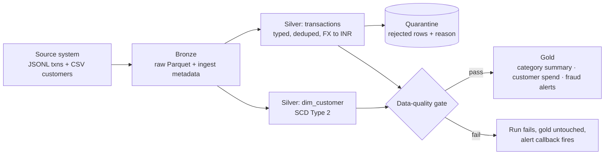
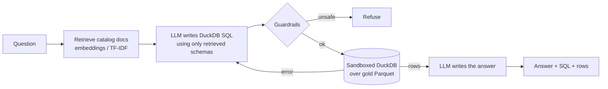

# card-txn-lakehouse

A daily **card-transactions lakehouse** built with **PySpark** and orchestrated with **Apache Airflow 3**, with an **LLM "ask your data" layer** on top (RAG + text-to-SQL + guardrails + evals):
raw files → **bronze → silver → gold** (medallion architecture), with a **data-quality gate**, an
**SCD Type 2** customer dimension, and **rule-based fraud alerts** built with Spark window functions.

The source data is synthetic but deliberately messy: duplicates, nulls, bad timestamps, unknown
currencies, late events and fraud-like bursts. That gives the pipeline real problems to handle.



## Airflow DAG

`generate_source → bronze.ingest_bronze → [silver.silver_transactions, silver.dim_customer_scd2] → data_quality_gate → build_gold → [ai_retrieval_eval, publish_summary]`

| Airflow feature | How it's used |
| --- | --- |
| `@daily` schedule + `{{ ds }}` | Every step is keyed by business date, so any day can be re-run or backfilled |
| `airflow backfill create` | Rebuild a date range in order (`make backfill FROM=… TO=…`) |
| `max_active_runs=1` + `depends_on_past` | The SCD2 dimension must be built one day at a time, in order |
| Task groups | `bronze` and `silver` groups; the two silver tasks run in parallel |
| Retries with exponential backoff | Transient failures retry; the DQ gate has `retries=0`, because bad data won't fix itself on retry |
| `on_failure_callback` | Alert hook (logs now; swap in Slack/email) |
| TaskFlow `@task` + XCom | `publish_summary` returns the day's metrics, visible in the UI |

## What each layer does

**Bronze** reads everything as strings with an explicit schema, so ingestion never breaks on bad values. It adds
`_source_file`, `_ingested_at` and `ds`, and writes Parquet partitioned by `ds` with **dynamic partition
overwrite**, so a re-run replaces only that day.

**Silver: transactions**
- Uses `try_cast` / `try_to_timestamp`. Spark 4 runs in **ANSI mode**, so a plain cast *throws* on bad input.
- Dedupes on `txn_id` with `row_number()` over a window, keeping the latest ingested copy.
- Validation rules send bad rows to `quarantine/` with a `reject_reason` instead of failing the job.
- Converts amounts to INR with a **broadcast join** to a small FX table, and flags late-arriving events.

**Silver: dim_customer (SCD2)**
- Hashes the tracked attributes (city, segment, risk tier) and compares them with the current version.
- When they differ, it closes the old row (`valid_to`, `is_current=false`) and opens a new one.
- It's **idempotent**: re-running a day first rolls the dimension back to its state before that day.

**Data-quality gate**
- **Checks:** row reconciliation (unique bronze = silver + quarantine), no duplicate keys, no null keys, quarantine rate ≤ 5%, no orphan customers.
- **Output:** writes `data/_dq/ds=…/report.json` and raises on failure, so gold is never built from bad data.

**Gold**
- `daily_category_summary`: spend by category × channel.
- `customer_daily_spend`: **point-in-time join** to SCD2, which gives the customer's segment *on that day*.
- `fraud_alerts`, three rules:
  - **velocity**: ≥5 transactions on one card within 10 minutes (range-frame window on epoch seconds).
  - **spike**: an amount over 10× the customer's trailing 30-day average (reads only 30 `ds` partitions, via partition pruning).
  - **foreign high-value**: a non-INR transaction over ₹1,00,000.

## Results from a real run (3 days, 200K transactions/day, local mode)

| Metric | Per day |
| --- | --- |
| Rows landed (bronze) | ~202,000 |
| Duplicates dropped | ~2,000 (1%) |
| Quarantined | ~2,200 (1.1%): missing customer ~1,000 · negative amount ~600 · unknown currency ~400 · bad timestamp ~200 |
| Clean rows (silver) | ~197,800 |
| SCD2 versions opened/closed | ~240 customers changed attributes |
| Fraud alerts | ~700 (≈0.35% of transactions): mostly spike, ~35 velocity, ~20 foreign |
| DQ checks | 6/6 pass; forcing a 0.5% quarantine threshold fails the gate and gold is skipped |
| End-to-end DAG run | ~90 s on a 2-core laptop-class VM |

## Run it

**With Docker:**
```bash
make up                          # Airflow :8080, Ollama :11434, API :8000
make model                       # one-time LLM download (qwen2.5-coder:7b, ~4.7 GB)
make backfill FROM=2026-09-20 TO=2026-09-24    # or trigger the DAG in the Airflow UI
# then open http://localhost:8000/docs and try POST /ask
```

**Without Docker (Java 17+ and Python 3.11):**
```bash
pip install -r requirements.txt
make test                        # 18 unit tests (pipeline + AI layer), no LLM needed
make run-day DS=2026-09-20       # runs every pipeline step for one day
ollama pull qwen2.5-coder:7b     # install Ollama from ollama.com first
make ask Q="Which merchant category had the highest total spend on the latest day?"
make eval                        # execution accuracy on the golden questions
```

Outputs are Parquet under `data/`: `bronze/`, `silver/`, `quarantine/`, `gold/`, `_dq/`.

## AI layer: "Ask your lakehouse"

Ask a question in plain English and get an answer, the SQL that produced it, and the raw rows.



```bash
curl -X POST localhost:8000/ask -H 'content-type: application/json' \
     -d '{"question": "What was the fraud alert rate on the latest day, as a percentage of transactions?"}'
```

| Piece | What it does |
| --- | --- |
| **Data catalog** (`ai/catalog.py`) | One doc per gold table (grain, meaning, columns) plus business-metric definitions. Column types, row counts and date ranges are read live, so docs never go stale. Metric docs **link to the tables they need**. |
| **Retrieval / RAG** (`ai/retrieval.py`) | `sentence-transformers` embeddings + cosine similarity, falling back to TF-IDF offline. Retrieved metric docs pull in their linked tables. |
| **LLM** (`ai/llm.py`) | Pluggable: **Ollama** (free, local; default `qwen2.5-coder:7b`) or any OpenAI-compatible API. Temperature 0. |
| **Guardrails** (`ai/guardrails.py` + `ai/warehouse.py`) | SELECT/WITH only, single statement, keyword blocklist, **table allow-list via DuckDB's own SQL parser**, forced `LIMIT 200`. Underneath, DuckDB runs with external file access **disabled and config locked**, so even a missed injection can't read files. |
| **Self-correction** (`ai/agent.py`) | If the SQL fails, the error goes back to the LLM for one retry. |
| **Evals** (`ai/evaluate.py`, `ai/golden.json`) | 12 golden questions with reference SQL. **Retrieval recall@4** (no LLM needed) and **execution accuracy** (the LLM's SQL must return the same result as the reference). |
| **API** (`ai/api.py`) | FastAPI: `POST /ask`, `GET /health`, `GET /catalog`, `POST /reload`. |
| **Airflow** | `ai_retrieval_eval` runs after `build_gold` and fails the run if recall drops below 0.9. |

**Eval results**

| Eval | Result |
| --- | --- |
| Retrieval recall@4 (TF-IDF), before linking metrics to tables | 91.7% (11/12). The fraud-rate question missed its second table |
| Retrieval recall@4 (TF-IDF), after linking | **100% (12/12)** |
| Execution accuracy with `qwen2.5-coder:7b` | *run `make eval` and record it here* |

Tests: 18 unit tests cover the guardrails (7 attack queries), the sandbox, a successful answer, self-correction after a SQL error, refusal of destructive SQL, and the API. They run offline using a scripted `FakeLLM`.

## How this maps to a production AWS setup

| Here | Production |
| --- | --- |
| Local folders under `data/` | S3 buckets per layer |
| Local-mode Spark via `BashOperator` | AWS Glue / EMR / Databricks jobs (`GlueJobOperator`, `DatabricksSubmitRunOperator`) |
| Parquet + directory swap for SCD2 | Delta Lake / Iceberg `MERGE INTO` with ACID transactions |
| Hand-written DQ checks | Great Expectations / Deequ / dbt tests |
| Logged alert callback | Slack / PagerDuty |
| `generate_source` task | `S3KeySensor` waiting for the upstream file |

## Tech

Python 3.11 · PySpark 4.0 · Apache Airflow 3.1 · Parquet · DuckDB · FastAPI · Ollama / OpenAI-compatible LLMs · sentence-transformers · scikit-learn · Docker · pytest
